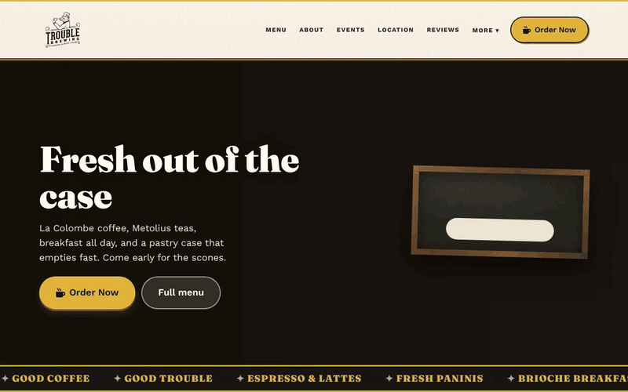
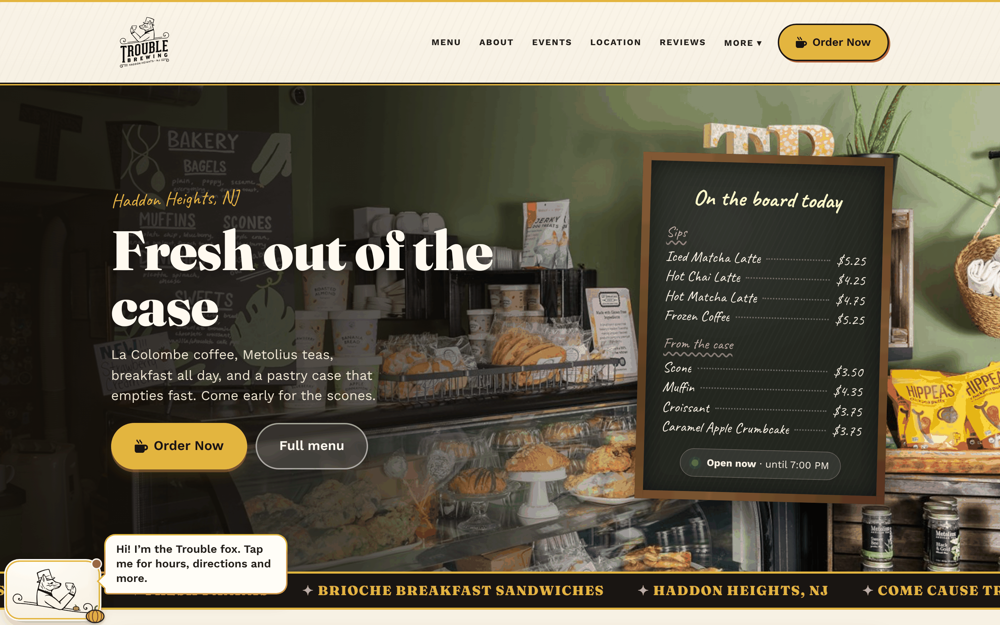
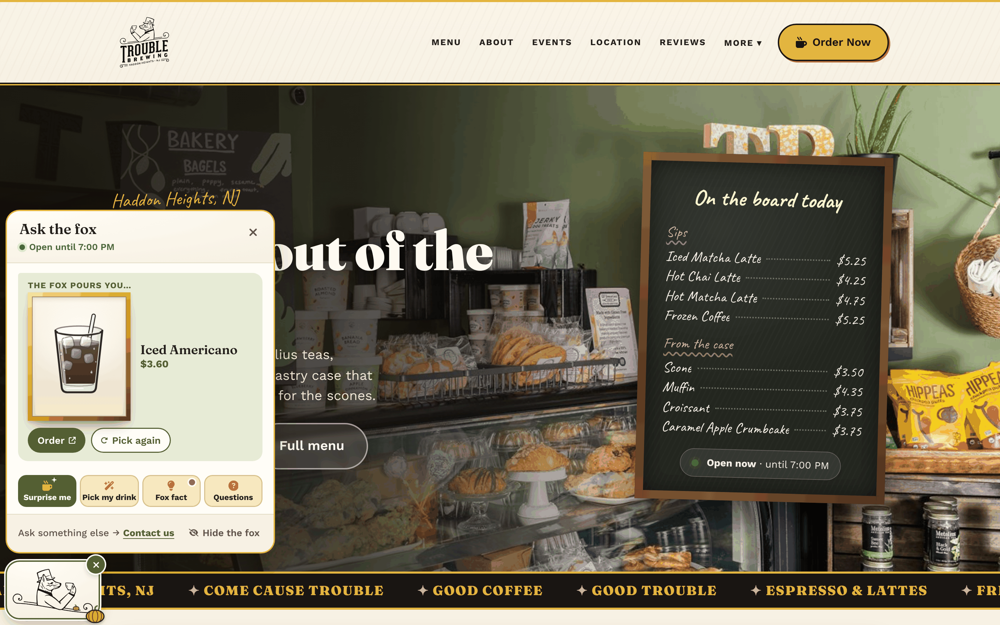
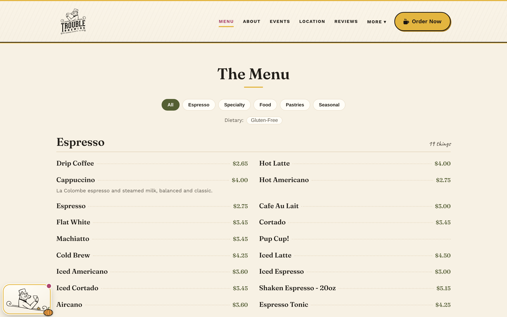
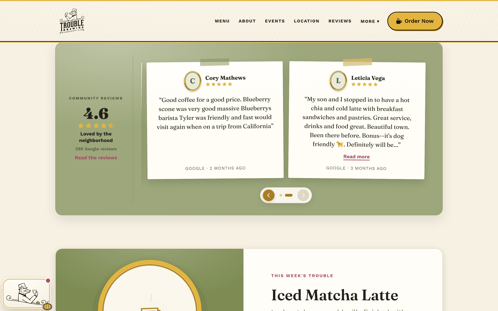
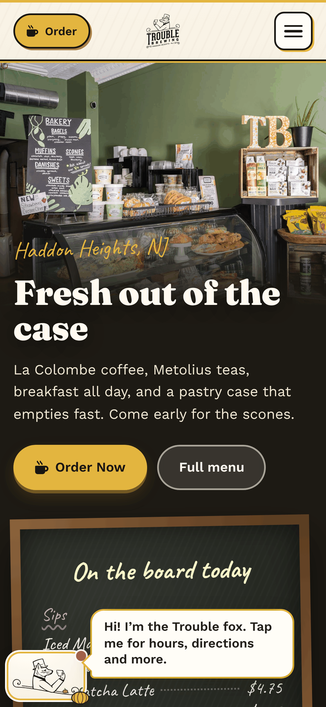
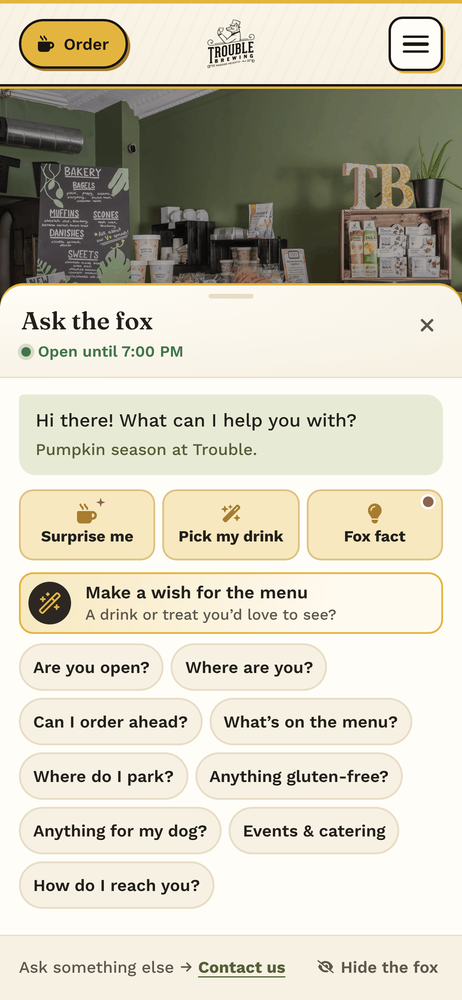
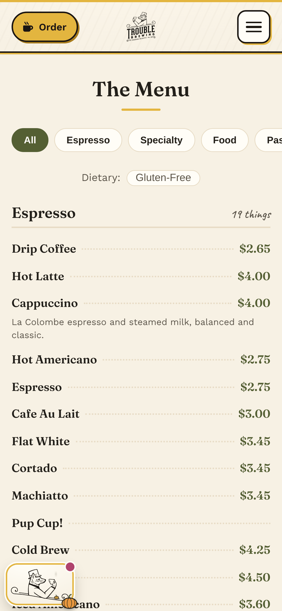

# ☕ Trouble Brewing Coffee House

Website **and** a Squarespace-style self-editing CMS for Trouble Brewing Coffee House — an independent coffee shop in Haddon Heights, NJ. Static React app on **GitHub Pages** (free), editable content in **Supabase** (free), read client-side via the RLS-gated anon key. Zero ongoing hosting cost beyond the domain.

<p align="center">
  
</p>

<table>
<tr>
<td width="50%"><p align="center"><sub>Fresh out of the case, with today's chalkboard</sub></p></td>
<td width="50%"><p align="center"><sub>Ask the fox: he picks your drink, answers questions and takes wishes</sub></p></td>
</tr>
<tr>
<td width="50%"><p align="center"><sub>Menu synced from SpotOn, with category and dietary filters</sub></p></td>
<td width="50%"><p align="center"><sub>Google reviews, pinned up like notes on the wall</sub></p></td>
</tr>
</table>

<p align="center">
  
  &nbsp;
  
  &nbsp;
  
</p>

## Highlights

- 🦊 **The Trouble fox**: the logo's top-hatted fox, animated (waves, sips, seasonal outfits). He answers visitor questions from the site's own data (hours, parking, gluten-free, dog-friendly) and runs little games: Surprise me, Pick my drink, daily fox facts and a make-a-wish box.
- 🧾 **"On the board today"** chalkboard specials and a live open-now hours board
- 📋 **Menu synced from SpotOn**, plus Order on SpotOn buttons on every page
- ✨ **GSAP** entrance and scroll animations
- 🛠️ **Owner CMS at `/admin`**: menu, chalkboard, events, hours, reviews, gallery, polls, the wish list, a media library and a homepage design switcher
- 🧯 **Never looks broken**: if the backend is down, everything falls back to bundled seed content

## Quick start

```bash
npm install
cp .env.example .env     # fill in Supabase + SpotOn values (optional for a local demo)
npm run dev              # runs from bundled seed content even without Supabase
npm run lint             # eslint, warnings included (--max-warnings 0)
npm test                 # route smoke tests (vitest + jsdom)
npm run build            # production build → dist/
```

`lint`, `test` and `build` are exactly what CI runs on every pull request
(`.github/workflows/ci.yml`), with no Supabase env — which is also what keeps
the seed fallbacks honest.

The site works **immediately** from bundled seed content (`src/lib/seed.js`) — no Supabase required to demo or deploy. Connect Supabase to unlock the live, owner-editable CMS at `/admin`.

## Set up the backend (Supabase)

1. Create a free Supabase project.
2. Run `supabase/schema.sql`, then `supabase/seed.sql` in the SQL editor.
3. Create admin users (Tom, Cat, Katie) under Auth.
4. Set `VITE_SUPABASE_URL` + `VITE_SUPABASE_ANON_KEY` (locally in `.env`, in prod as GitHub Action secrets).
5. (Optional) Deploy the Edge Functions in `supabase/functions/` for form emails + Google reviews.

## Documentation

Everything lives in [`/docs`](./docs) — start with **[docs/PROJECT.md](./docs/PROJECT.md)** and **[docs/TODO.md](./docs/TODO.md)**.

| | |
|---|---|
| [ARCHITECTURE](./docs/ARCHITECTURE.md) | Hosting model, data flow, section-based CMS, SpotOn menu sync |
| [CMS](./docs/CMS.md) | Section types, data shapes, renderers & editors |
| [PAGES](./docs/PAGES.md) · [CONTENT](./docs/CONTENT.md) · [DESIGN](./docs/DESIGN.md) | Pages, seed content, look & feel |
| [INTEGRATIONS](./docs/INTEGRATIONS.md) · [DEPLOYMENT](./docs/DEPLOYMENT.md) | Supabase, Google, Mailchimp, GA4; Pages + DNS |
| [DECISIONS](./docs/DECISIONS.md) · [OWNER-GUIDE](./docs/OWNER-GUIDE.md) | Why we chose what; how owners edit the site |

## Tech

React + Vite · React Router (GitHub Pages SPA fallback) · Supabase (Postgres + Auth + Storage + Edge Functions) · client-side image compression · consent-gated GA4.
